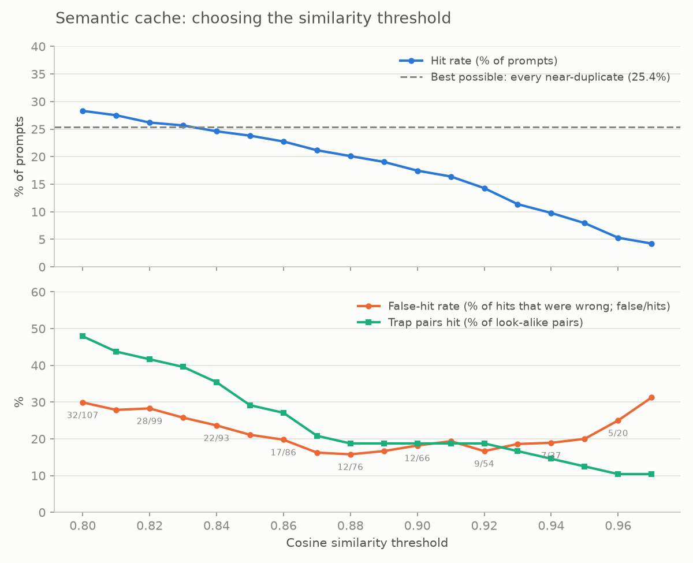

# LLM Gateway

An OpenAI-compatible proxy in front of multiple LLM providers, with fallback, per-key rate
limits, exact and semantic caching, PII masking and a cost dashboard.

Status: Phase 9 done (Groq + Gemini behind model aliases with retry and fallback, streaming,
API keys, per-key rate limits, a request log with the cost of every call, an exact-match and
an opt-in semantic cache, PII masking, and `model: "auto"`, which picks the cheap or the
strong alias per request). See [plan.md](plan.md) for the roadmap.

## Quick start

```bash
uv sync                                   # create .venv and install deps
cp .env.example .env                      # then add your provider keys
docker compose up -d                      # Postgres 17 + pgvector on localhost:5433
uv run python -m scripts.migrate          # create/update tables (safe to rerun)
uv run uvicorn app.main:app --reload      # http://localhost:8000/health
uv run pytest
uv run ruff check .
```

Clients ask for a model **alias**, not a vendor model. Aliases and the providers behind them
live in [config/models.yaml](config/models.yaml):

| Alias | Tried in order | |
|---|---|---|
| `fast` | Groq `openai/gpt-oss-20b` → Gemini `gemini-3.5-flash-lite` | cheap, quick |
| `strong` | Groq `openai/gpt-oss-120b` → Gemini `gemini-3.8-flash` | better answers |
| `auto` | `fast` or `strong`, picked per request | see [below](#cheap-vs-strong-router-auto) |
| `mock` | mock provider | no provider keys needed |
| `demo-fallback` | always-failing mock → mock | fallback demo, no provider keys |
| `demo-midstream` | mock that fails mid-answer → mock | streaming failure demo, no provider keys |

`GET /v1/models` lists the aliases this deployment can serve. If a provider times out, rate
limits (429) or errors (5xx), the gateway retries once where that helps and moves to the next
entry. It doesn't fall back on a bad request (400), which every provider would reject. The
response's `model` is the model that actually answered, and the `x-gateway-provider`,
`x-gateway-attempts` and `x-gateway-fallback` headers show how it got there.

Providers retire models and change free-tier access often. Check the registry against what
your keys can actually use:

```bash
uv run python -m scripts.check_models
```

Every `/v1` request needs a gateway API key (`/health` doesn't). Keys are created with a CLI
that talks to Postgres directly; the plain key is printed once and only its hash is stored:

```bash
uv run python -m scripts.create_key create "alice" --rpm 60 --tpm 100000
uv run python -m scripts.create_key list
uv run python -m scripts.create_key revoke 1     # applies within KEY_CACHE_TTL_S (30 s)
```

Each key has a requests-per-minute and a tokens-per-minute limit. Over either, the gateway
answers 429 with `Retry-After` (the openai SDK waits and retries by itself), and every reply
carries OpenAI's `x-ratelimit-limit-*`, `x-ratelimit-remaining-*` and `x-ratelimit-reset-*`
headers for requests and tokens. A request's tokens are reserved up front (prompt plus
`max_tokens`, or 1024 without it) and corrected to the real usage when it ends. Limits are kept
in memory, so run the gateway as a single process.

Try it with the official `openai` SDK (needs `GROQ_API_KEY` and `GEMINI_API_KEY` in `.env`).
It asks once, asks the same again (a cache hit), then asks the same as a stream (a hit replayed
as SSE), and prints what the cache did and how long each call took:

```bash
GATEWAY_API_KEY=gw-... uv run python scripts/smoke_openai_sdk.py                  # model "fast"
GATEWAY_API_KEY=gw-... uv run python scripts/smoke_openai_sdk.py --model strong
GATEWAY_API_KEY=gw-... uv run python scripts/smoke_openai_sdk.py --model mock     # no provider keys needed
```

To watch fallback without any provider keys, ask for `demo-fallback`. Its first provider always fails
with a 503 and is retried once, then the mock answers:

```bash
curl -si localhost:8000/v1/chat/completions -H "Authorization: Bearer $GATEWAY_API_KEY" \
  -H 'content-type: application/json' \
  -d '{"model": "demo-fallback", "messages": [{"role": "user", "content": "hi"}]}'
```

Look for `x-gateway-provider: mock`, `x-gateway-attempts: 3` and `x-gateway-fallback: true`.

### Streaming

`stream=True` returns server-sent events in OpenAI's chunk format, ending with `data: [DONE]`.
Add `stream_options={"include_usage": True}` to get a final chunk with token usage. Fallback
works until the first token: the gateway picks a provider before it starts the response, so a
provider that fails early is replaced, and if all of them fail you get a normal JSON error. Once
part of the answer has been sent, a failure ends the stream with an error event instead of
`[DONE]`, and the openai SDK raises it as an `APIError`. `demo-midstream` shows this:

```bash
curl -sN localhost:8000/v1/chat/completions -H "Authorization: Bearer $GATEWAY_API_KEY" \
  -H 'content-type: application/json' \
  -d '{"model": "demo-midstream", "stream": true, "messages": [{"role": "user", "content": "hi"}]}'
```

Every provider streams: Groq passes its OpenAI-format chunks through, and Gemini's
`streamGenerateContent` events are translated into the same format.

### Caching

A request with `temperature` set at or below `CACHE_MAX_TEMPERATURE` (0.2) is answered from the
exact-match cache when the same request was answered before, within `CACHE_TTL_S` (24 h). "The
same" means the same alias, messages and every option the model sees (`max_tokens`, `tools`,
`stop`, `seed`...); `stream` and `user` don't count, so a streamed answer can serve a plain
request and the other way round. A hit on a stream is replayed as SSE chunks. One cache serves
every API key, stored in Postgres (`response_cache`).

Every reply says what happened in `x-gateway-cache`: `exact` (a hit, a few milliseconds, no
provider call, `x-gateway-attempts: 0`), `semantic` (a hit on a similar question, for requests
that opt in: see below), `miss`, or `bypass`. Requests without a temperature, above the
limit, or with `n` > 1 are bypassed, and so is any request sent with `x-gateway-cache: off`.
A hit still counts against the key's requests per minute but uses no tokens, and its
request-log row has `cache_status = 'exact'` (or `'semantic'`) and $0. Only finished text answers
are stored: not errors, cut streams, tool calls or empty replies (a reasoning model that spends
all of `max_tokens` thinking returns no text, and isn't cached).

The demo commands above send no temperature, so they always reach the providers. To repeat a
cacheable request without the cache, add `-H 'x-gateway-cache: off'`.

Known limit: two identical requests that arrive at the same moment both call the provider.

### Semantic cache

The semantic cache answers a question *similar* to one already answered: "What's the capital
of Canada?" after "What is the capital of Canada?". It's **opt-in per request**: send
`x-gateway-cache: semantic`. The exact cache is still checked first, and a semantic hit
says `semantic` in `x-gateway-cache`, costs $0 and is logged with `cache_status = 'semantic'`.
Opt-in, because it gives wrong answers, and only the app knows whether a near answer is good
enough.

```bash
curl -s localhost:8000/v1/chat/completions -H "Authorization: Bearer $KEY" \
  -H 'x-gateway-cache: semantic' -H 'Content-Type: application/json' \
  -d '{"model": "fast", "temperature": 0, "messages": [{"role": "user", "content": "What'"'"'s the capital of Canada?"}]}'
```

With the openai SDK: `extra_headers={"x-gateway-cache": "semantic"}`, or `default_headers` on
the client. `scripts/smoke_openai_sdk.py --semantic "a rephrasing"` runs the whole flow.

It embeds the user message with all-MiniLM-L6-v2 and serves a stored answer when the cosine
similarity is at least `SEMANTIC_CACHE_THRESHOLD` (0.95) **and** both prompts hold the same
numbers. Only single-turn requests are embedded: an optional system message and one user
message, no tools. A chat with earlier turns skips the semantic cache. Everything else in the
request (alias, system prompt, `max_tokens`, `stop`...) must match exactly, and a key is only
ever served its own entries: a semantic hit answers a different question, which may carry
another team's details. A miss adds about 25 ms (embedding plus the lookup) to the provider
call.

The model (about 90 MB) downloads from Hugging Face on the first start and is cached after.
Loading it adds about 12 s to startup and about 430 MB of memory; `SEMANTIC_CACHE_ENABLED=false`
skips it, and so does a model that fails to load (the gateway logs a warning and runs with the
exact cache alone).

**Measured** by replaying `data/queries.jsonl` (378 prompts, 96 near-duplicates, 48 look-alike
"trap" pairs) through `uv run python -m scripts.eval_semantic_cache` (it writes the chart and
`docs/semantic_threshold.csv`):

| Threshold 0.95, with the numbers guard | |
|---|---|
| Hit rate | **7.1%** of prompts (27), out of a possible 25.4% |
| False-hit rate | **14.8%**: 4 of the 27 hits answered a different question |
| Trap pairs answered wrongly | 4 of 48 (8.3%) |



No threshold from 0.80 to 0.97 is free of wrong answers. Embedding similarity can't see word
order: "convert a string to an integer in JavaScript" and "an integer to a string" score
0.996, and "100 miles to kilometres" vs "100 kilometres to miles" 0.993. The numbers guard
catches questions a digit apart ($1.10 vs $1.20) but not those. The log is adversarial on
purpose (one near pair in three is a trap), so real traffic should do better, but that isn't
measured. Details and what was tried (a cross-encoder check, which did worse): `docs/decisions.md`.

### PII masking

Every request has its emails, Indian mobile numbers, Aadhaar numbers and card numbers swapped
for placeholders before anything else sees it. The providers, both caches and the request
log only ever get `[EMAIL_1]`, `[PHONE_1]`, `[AADHAAR_1]`, `[CARD_1]`. The reply gets the real
values back, plain or streamed, so a client sees its own data as usual:

```
client sends:    Write to priya@example.com and call 98765 43210.
provider gets:   Write to [EMAIL_1] and call [PHONE_1].   (and a system note on placeholders)
provider says:   Done: I've drafted a note to [EMAIL_1].
client gets:     Done: I've drafted a note to priya@example.com.
```

Aadhaar numbers must pass the Verhoeff checksum, and cards Luhn and a card network's first
digit, so most random 12- or 16-digit IDs aren't masked. Each request-log row has
`pii_types`, the kinds masked (`{email,phone}`), never the values. Placeholders are the same
for the same request shape, so two requests that differ only in their PII share one cache
entry, and each gets its own values back.

**Measured** with `scripts/check_pii_live.py` (8 prompts asking for 22 values back, plain and
streamed): every placeholder a model wrote came back exactly as sent, so restoring by exact
match works. Gemini 3.5 Flash-Lite returned all 22 values. Groq's gpt-oss-20b returned only
13 to 18 of 22: it treats a placeholder as a blank to fill or as private data, and refuses
or makes up a stand-in. A one-line note explaining the placeholders brought every model to 22
of 22, so the gateway now adds it to every masked request. It goes ahead of the client's
system message, or becomes the system message if there's none, and costs 53 tokens.
Re-measured through the gateway: 22 of 22 on every model (details: `docs/decisions.md`).
Requests with no PII get no note.

Known limits:

- **Tool calls:** arguments aren't masked in requests or restored in replies. Only message
  text is.
- **Coverage:** only those four kinds. Names, addresses, PAN, passport numbers and non-Indian
  phone formats pass through.
- **Over-masking:** a 10-digit number starting 6-9 is masked as a phone, even when it's an
  order ID.
- **Literal placeholders:** if a user types `[EMAIL_1]` themselves, it's replaced with the
  request's first email.
- **One spelling restored:** a value written two ways comes back in the spelling first seen.
- **Dropped placeholders:** a model that drops a placeholder drops the value with it. The note
  stopped that in every measured run, but there's no guarantee.

### Cheap-vs-strong router (`auto`)

`model: "auto"` lets the gateway pick: a request goes to `strong` if any rule below matches,
and to `fast` otherwise. The rules are checked in this order, and the first match is the
reason:

| Reason | Matches when | Reads |
|---|---|---|
| `long_answer` | `max_tokens` ≥ 2048 | the request |
| `long_conversation` | 5 or more user messages | the request |
| `code_block` | a ``` fence | last user message |
| `pasted_text` | 3 or more non-empty lines | last user message |
| `long_prompt` | 20 or more tokens | last user message |
| `keyword:<word>` | a keyword such as `implement`, `prove`, `step by step`, `explain` | last user message |
| `default` | nothing above: goes to `fast` | |

The thresholds and keywords are in the `auto:` section of
[config/models.yaml](config/models.yaml). Routing runs after PII masking, on what the provider
will see, and is deterministic, so `auto` shares cache entries with the alias it picks. The
reply carries `x-gateway-route: fast` and `x-gateway-route-reason: default`. The request log
keeps `requested_model = auto`, and adds `routed_alias` and `route_reason` (a rule name, never
request text).

```bash
uv run python -m scripts.eval_router --show-misses     # offline, on data/queries.jsonl
```

**Measured** on the 378 labelled prompts, with a train/test split (details:
`docs/decisions.md`): `auto` sends 64% of the test split to `fast`, about 32% cheaper than
sending everything to `strong` at list price. 2 of 36 hard prompts went to `fast` (6%), and 2
of 64 easy ones went to `strong` (3%). The plan's first keyword list (`write code`, `prove`,
`step by step`, `analyze`) sent 81% of the hard prompts to `fast`.

**Spot-checked live** with `scripts/check_router_live.py`: 26 prompts `auto` sends to `fast`,
including all 11 labelled hard, were answered by both aliases. `fast` got every one right,
the hard ones included, and only one answer had a wrong side remark. The answers are side by
side in [docs/router_spotcheck.md](docs/router_spotcheck.md).

Known limits:

- **Fitted to its own dataset:** the keywords were written by someone who had read the
  prompts, and the dataset's easy prompts are all short. On real traffic, expect more long
  easy prompts to go to `strong`, and more hard prompts with no keyword to go to `fast`.
- **No second chance:** a weak answer from `fast` isn't retried on `strong`.
- **English keywords:** a hard question in Hindi only reaches `strong` by its length.
- **Startup:** for the first seconds, until tiktoken has loaded, tokens are counted as
  characters / 4, so a prompt right at the length threshold may be routed either way.

## Layout

```
app/
  api/          OpenAI-compatible /v1 routes
  providers/    Groq, Gemini and mock adapters
  routing/      model registry, cheap-vs-strong router
  auth/         API keys, rate limits
  cache/        exact-match and semantic caches
  guardrails/   PII masking
  usage/        request logs, cost
  config.py     settings from env / .env
  main.py       FastAPI app
data/queries.jsonl       evaluation query log (built by scripts/build_dataset.py)
dashboard/               Streamlit cost dashboard
docs/decisions.md        design decisions, one entry per phase
```

## Query log

`data/queries.jsonl` has 378 prompts for evaluating the cache and router. Each row has an
`id`, `prompt`, `category`, `difficulty` (`easy`/`hard`), and two optional links:

- `dup_of`: a near-duplicate of another prompt (same meaning). The semantic cache should hit.
- `trap_of`: looks similar to another prompt but needs a different answer. The cache must not hit.

Edit the prompts in `scripts/build_dataset.py` and regenerate with
`uv run python scripts/build_dataset.py`.
