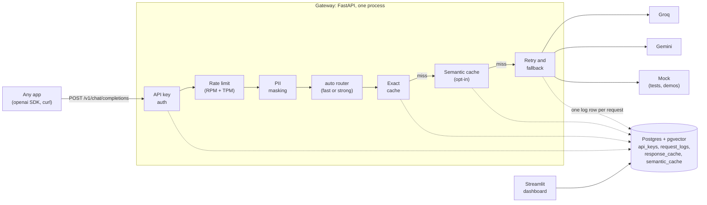

# LLM Gateway

One OpenAI-compatible endpoint in front of Groq and Gemini. Apps keep using the plain `openai`
SDK; the gateway adds API keys and per-key rate limits, PII masking, an exact and a semantic
cache, a cheap-vs-strong router, retry and fallback between providers, and a log of what every
call cost, shown on a dashboard.

**Measured, not claimed** (every number comes from a script in this repo):

- **33.6% cheaper** on a replayed log of 378 prompts: the router and the caches together,
  against sending everything to the strong model. [Replay results](#results)
- **99.3% of requests served with the primary provider down**, against 0% without fallback.
  [Fallback](#fallback-measured)
- **2.8 ms p50** added by the gateway itself (caches off), 3.8 ms with the exact cache.
- **The semantic cache is honest about its errors:** 7.1% of prompts hit at the chosen
  threshold, and 14.8% of those hits answered a different question. That's why it's opt-in.
  [Threshold chart](#results)
- **PII round trip:** emails, phone, Aadhaar and card numbers never reach a provider, and
  22 of 22 values came back in the replies on every model tested. [PII masking](#pii-masking)

Built with Python 3.12, FastAPI, httpx, Postgres + pgvector, sentence-transformers and
Streamlit. Design decisions, one entry per phase, are in [docs/decisions.md](docs/decisions.md).

## Demo

> **Demo video: not recorded yet.** The 2-minute recording will follow the script below; every
> step runs from this repo today.

1. **The plain openai SDK pointed at the gateway.** `scripts/smoke_openai_sdk.py` only changes
   `base_url` and `api_key`:
   `GATEWAY_API_KEY=gw-... uv run python scripts/smoke_openai_sdk.py`
2. **Streaming.** The same script's third call streams; `x-gateway-cache` says whether it was
   replayed from the cache.
3. **A cache hit.** Its second call repeats the first: answered in milliseconds, $0, no
   provider call (`x-gateway-cache: exact`, `x-gateway-attempts: 0`).
4. **Killing a provider.** `model: "demo-fallback"` puts an always-failing provider first: the
   reply comes from the backup, with `x-gateway-fallback: true` ([command](#models-and-fallback)).
5. **The dashboard.** `uv run --env-file .env --group dashboard streamlit run dashboard/app.py`:
   spend and savings per key, hit rate, fallback rate, latency.

## Architecture



One Postgres holds the keys, the request log and both caches (pgvector for the semantic one),
so there's no separate vector store or cache server to run. The dashboard reads Postgres
directly and doesn't need the gateway running.

### Request lifecycle

What happens to one `POST /v1/chat/completions`, in the order of
[app/api/routes.py](app/api/routes.py):

1. **Auth.** The `Authorization: Bearer gw-...` key is hashed and looked up. A bad or revoked
   key gets OpenAI's 401, which the SDK raises as `AuthenticationError`.
2. **Rate limit.** The request reserves one request and its tokens (prompt plus `max_tokens`)
   from the key's buckets. Over either limit: 429 with `Retry-After`, which the SDK waits out
   by itself. From here on, every request gets a row in the request log, rejected ones too.
3. **PII masking.** Emails, phone, Aadhaar and card numbers become `[EMAIL_1]`-style
   placeholders. Nothing after this step sees the real values: not the caches, the providers
   or the log.
4. **`auto` router.** `model: "auto"` becomes `fast` or `strong` by a few cheap rules (length,
   code, keywords). It runs before the caches, so `auto` shares cache entries with the alias
   it picks.
5. **Exact cache.** The same alias, messages and options at a low temperature, answered in the
   last 24 h: replied at once, for $0.
6. **Semantic cache,** only when the request opts in with `x-gateway-cache: semantic`. A
   similar enough question from the same key (cosine ≥ 0.95, same numbers) gets its answer.
7. **Provider, with retry and fallback.** The alias's providers are tried in order. A timeout,
   429 or 5xx is retried once where that helps, then the next provider is tried; a 400 isn't.
   A stream can fall back until its first token, not after.
8. **Reply.** Placeholders are swapped back for the real values, in plain and streamed replies.
   Headers say what happened: `x-gateway-provider`, `-attempts`, `-fallback`, `-cache`,
   `-route`, and OpenAI's `x-ratelimit-*`.
9. **After the reply.** The reservation is corrected to the real token count; the answer is
   stored in the caches if it's worth serving again; and a log row records the key, alias,
   provider, model, tokens, cost at list price, latency, cache status, route and the kinds of
   PII masked (never the values). These writes run in the background and can't fail the
   request.

## Results

### Replay: what the cache and the router save

All 378 prompts of [data/queries.jsonl](data/queries.jsonl) sent through the gateway three
ways, on Groq at list price (2026-10-25). `fast` is gpt-oss-20b, `strong` gpt-oss-120b, at
about half its price per token:

| Mode | Cost (USD) | Saved | Cache hits | Sent to the cheap model | p50 latency |
|---|--:|--:|--:|--:|--:|
| baseline: everything to `strong`, no cache | 0.0805 | - | 0.0% | - | 1,525 ms |
| cache: everything to `strong` | 0.0741 | 7.9% | 7.1% | - | 1,491 ms |
| cache + router: `model: "auto"` | 0.0535 | **33.6%** | 6.6% | 67.5% | 1,056 ms |

Most of the saving is the router. Quality isn't scored here, only cost and speed; the cheap
model's answers were spot-checked in [docs/router_spotcheck.md](docs/router_spotcheck.md).
The full table (false hits, p95, fallbacks), the gateway's own overhead and what the numbers
mean are under [Replay benchmark](#replay-benchmark).

### The semantic cache threshold


Hit rate and false-hit rate of the semantic cache at each similarity threshold, on the same
378 prompts, which plant 96 rephrasings and 48 look-alike "trap" questions. No threshold is
free of wrong answers: embeddings can't see word order ("100 miles to kilometres" and
"100 kilometres to miles" score 0.993). Details under [Semantic cache](#semantic-cache).

## Known limitations

- **Not deployed yet:** no Dockerfile, CI, live URL or public demo key. It runs locally.
- **One process:** rate-limit buckets live in memory, so the gateway runs as a single worker,
  and a restart gives every key a full bucket.
- **The semantic cache gives wrong answers** (14.8% of its hits on the replayed log), which is
  why it's opt-in per request. [Details](#semantic-cache)
- **The router is fitted to its own dataset,** and a weak answer from `fast` isn't retried on
  `strong`. [Details](#cheap-vs-strong-router-auto)
- **PII masking covers four kinds** (email, Indian phone, Aadhaar, card numbers), message text
  only, not tool-call arguments. [Details](#pii-masking)
- **No budgets, alerts or prompt-injection checks.** The dashboard shows spend; nothing stops it.
- **No fallback mid-stream:** once part of an answer is sent, a provider failure ends the
  stream with an error event. [Details](#streaming)
- **Two identical requests at the same moment** both call the provider; the cache doesn't
  hold the second one back.
- **The benchmark's hit rate is the dataset's,** a quarter of which is planted rephrasings.
  Real traffic would hit more or less often depending on how repetitive it is.

## Why not LiteLLM?

For production, use LiteLLM, Portkey or a hosted gateway: they already do fallbacks, caching,
rate limits, budgets and spend tracking, across far more providers than this. This project
exists to build those parts from scratch and measure them: how often a semantic cache answers
the wrong question, how often a keyword router sends a hard prompt to the cheap model, whether
masked PII survives a round trip through a model, and how much availability fallback buys. The
answers, and what didn't work (a cross-encoder check that made the cache worse), are in
[docs/decisions.md](docs/decisions.md).

## Quick start

```bash
uv sync                                   # create .venv and install deps
cp .env.example .env                      # then add your provider keys
docker compose up -d                      # Postgres 17 + pgvector on localhost:5433
uv run python -m scripts.migrate          # create/update tables (safe to rerun)
uv run uvicorn app.main:app --reload      # http://localhost:8000/health
uv run pytest
uv run ruff check .
```

## Reference

### Models and fallback

Clients ask for a model **alias**, not a vendor model. Aliases and the providers behind them
live in [config/models.yaml](config/models.yaml):

| Alias | Tried in order | |
|---|---|---|
| `fast` | Groq `openai/gpt-oss-20b` → Gemini `gemini-3.5-flash-lite` | cheap, quick |
| `strong` | Groq `openai/gpt-oss-120b` → Gemini `gemini-3.8-flash` | better answers |
| `auto` | `fast` or `strong`, picked per request | see [below](#cheap-vs-strong-router-auto) |
| `mock` | mock provider | no provider keys needed |
| `demo-fallback` | always-failing mock → mock | fallback demo, no provider keys |
| `demo-midstream` | mock that fails mid-answer → mock | streaming failure demo, no provider keys |

`GET /v1/models` lists the aliases this deployment can serve. If a provider times out, rate
limits (429) or errors (5xx), the gateway retries once where that helps and moves to the next
entry. It doesn't fall back on a bad request (400), which every provider would reject. The
response's `model` is the model that actually answered, and the `x-gateway-provider`,
`x-gateway-attempts` and `x-gateway-fallback` headers show how it got there.

Providers retire models and change free-tier access often. Check the registry against what
your keys can actually use:

```bash
uv run python -m scripts.check_models
```

### API keys and rate limits

Every `/v1` request needs a gateway API key (`/health` doesn't). Keys are created with a CLI
that talks to Postgres directly; the plain key is printed once and only its hash is stored:

```bash
uv run python -m scripts.create_key create "alice" --rpm 60 --tpm 100000
uv run python -m scripts.create_key list
uv run python -m scripts.create_key revoke 1     # applies within KEY_CACHE_TTL_S (30 s)
```

Each key has a requests-per-minute and a tokens-per-minute limit. Over either, the gateway
answers 429 with `Retry-After` (the openai SDK waits and retries by itself), and every reply
carries OpenAI's `x-ratelimit-limit-*`, `x-ratelimit-remaining-*` and `x-ratelimit-reset-*`
headers for requests and tokens. A request's tokens are reserved up front (prompt plus
`max_tokens`, or 1024 without it) and corrected to the real usage when it ends. Limits are kept
in memory, so run the gateway as a single process.

### Trying it with the openai SDK

Try it with the official `openai` SDK (needs `GROQ_API_KEY` and `GEMINI_API_KEY` in `.env`).
It asks once, asks the same again (a cache hit), then asks the same as a stream (a hit replayed
as SSE), and prints what the cache did and how long each call took:

```bash
GATEWAY_API_KEY=gw-... uv run python scripts/smoke_openai_sdk.py                  # model "fast"
GATEWAY_API_KEY=gw-... uv run python scripts/smoke_openai_sdk.py --model strong
GATEWAY_API_KEY=gw-... uv run python scripts/smoke_openai_sdk.py --model mock     # no provider keys needed
```

### Watching fallback

To watch fallback without any provider keys, ask for `demo-fallback`. Its first provider always fails
with a 503 and is retried once, then the mock answers:

```bash
curl -si localhost:8000/v1/chat/completions -H "Authorization: Bearer $GATEWAY_API_KEY" \
  -H 'content-type: application/json' \
  -d '{"model": "demo-fallback", "messages": [{"role": "user", "content": "hi"}]}'
```

Look for `x-gateway-provider: mock`, `x-gateway-attempts: 3` and `x-gateway-fallback: true`.

### Fallback, measured

`scripts/check_fallback.py` sends 1,000
requests (half streamed, caches off) to each alias in [config/outage.yaml](config/outage.yaml):
mock providers that fail a set share of calls with a 503 before the first token. Each failing
provider is tried alone, and with a backup (itself failing 10% of calls) behind it. Free, no
provider keys:

```bash
MODELS_FILE=config/outage.yaml SEMANTIC_CACHE_ENABLED=false uv run uvicorn app.main:app --port 8002
uv run python -m scripts.check_fallback --base-url http://localhost:8002/v1
```

Results from 2026-10-26:

| Primary provider | Alone | With fallback | Expected with fallback |
|---|--:|--:|--:|
| down (fails every call) | 0.0% | 99.3% | 99% (the backup fails twice: 0.1²) |
| flaky (fails half its calls) | 75.9% | 99.8% | 99.75% (0.5² × 0.1²) |

A 503 is retried once on the same provider, which is why the flaky provider alone still serves
about 75% (1 − 0.5²). Streamed and plain requests did the same: a stream counts only if it
ended with `data: [DONE]`. These mocks fail before the first token, where fallback is still
possible; a failure partway through a stream can't fall back (see Streaming).

### Streaming

`stream=True` returns server-sent events in OpenAI's chunk format, ending with `data: [DONE]`.
Add `stream_options={"include_usage": True}` to get a final chunk with token usage. Fallback
works until the first token: the gateway picks a provider before it starts the response, so a
provider that fails early is replaced, and if all of them fail you get a normal JSON error. Once
part of the answer has been sent, a failure ends the stream with an error event instead of
`[DONE]`, and the openai SDK raises it as an `APIError`. `demo-midstream` shows this:

```bash
curl -sN localhost:8000/v1/chat/completions -H "Authorization: Bearer $GATEWAY_API_KEY" \
  -H 'content-type: application/json' \
  -d '{"model": "demo-midstream", "stream": true, "messages": [{"role": "user", "content": "hi"}]}'
```

Every provider streams: Groq passes its OpenAI-format chunks through, and Gemini's
`streamGenerateContent` events are translated into the same format.

### Caching

A request with `temperature` set at or below `CACHE_MAX_TEMPERATURE` (0.2) is answered from the
exact-match cache when the same request was answered before, within `CACHE_TTL_S` (24 h). "The
same" means the same alias, messages and every option the model sees (`max_tokens`, `tools`,
`stop`, `seed`...); `stream` and `user` don't count, so a streamed answer can serve a plain
request and the other way round. A hit on a stream is replayed as SSE chunks. One cache serves
every API key, stored in Postgres (`response_cache`).

Every reply says what happened in `x-gateway-cache`: `exact` (a hit, a few milliseconds, no
provider call, `x-gateway-attempts: 0`), `semantic` (a hit on a similar question, for requests
that opt in: see below), `miss`, or `bypass`. Requests without a temperature, above the
limit, or with `n` > 1 are bypassed, and so is any request sent with `x-gateway-cache: off`.
A hit still counts against the key's requests per minute but uses no tokens, and its
request-log row has `cache_status = 'exact'` (or `'semantic'`) and $0. Only finished text answers
are stored: not errors, cut streams, tool calls or empty replies (a reasoning model that spends
all of `max_tokens` thinking returns no text, and isn't cached).

The demo commands above send no temperature, so they always reach the providers. To repeat a
cacheable request without the cache, add `-H 'x-gateway-cache: off'`.

Known limit: two identical requests that arrive at the same moment both call the provider.

### Semantic cache

The semantic cache answers a question *similar* to one already answered: "What's the capital
of Canada?" after "What is the capital of Canada?". It's **opt-in per request**: send
`x-gateway-cache: semantic`. The exact cache is still checked first, and a semantic hit
says `semantic` in `x-gateway-cache`, costs $0 and is logged with `cache_status = 'semantic'`.
Opt-in, because it gives wrong answers, and only the app knows whether a near answer is good
enough.

```bash
curl -s localhost:8000/v1/chat/completions -H "Authorization: Bearer $KEY" \
  -H 'x-gateway-cache: semantic' -H 'Content-Type: application/json' \
  -d '{"model": "fast", "temperature": 0, "messages": [{"role": "user", "content": "What'"'"'s the capital of Canada?"}]}'
```

With the openai SDK: `extra_headers={"x-gateway-cache": "semantic"}`, or `default_headers` on
the client. `scripts/smoke_openai_sdk.py --semantic "a rephrasing"` runs the whole flow.

It embeds the user message with all-MiniLM-L6-v2 and serves a stored answer when the cosine
similarity is at least `SEMANTIC_CACHE_THRESHOLD` (0.95) **and** both prompts hold the same
numbers. Only single-turn requests are embedded: an optional system message and one user
message, no tools. A chat with earlier turns skips the semantic cache. Everything else in the
request (alias, system prompt, `max_tokens`, `stop`...) must match exactly, and a key is only
ever served its own entries: a semantic hit answers a different question, which may carry
another team's details. A miss adds about 25 ms (embedding plus the lookup) to the provider
call.

The model (about 90 MB) downloads from Hugging Face on the first start and is cached after.
Loading it adds about 12 s to startup and about 430 MB of memory; `SEMANTIC_CACHE_ENABLED=false`
skips it, and so does a model that fails to load (the gateway logs a warning and runs with the
exact cache alone).

**Measured** by replaying `data/queries.jsonl` (378 prompts, 96 near-duplicates, 48 look-alike
"trap" pairs) through `uv run python -m scripts.eval_semantic_cache` (it writes the chart and
`docs/semantic_threshold.csv`):

| Threshold 0.95, with the numbers guard | |
|---|---|
| Hit rate | **7.1%** of prompts (27), out of a possible 25.4% |
| False-hit rate | **14.8%**: 4 of the 27 hits answered a different question |
| Trap pairs answered wrongly | 4 of 48 (8.3%) |

The chart of hit rate and false-hit rate by threshold is under [Results](#the-semantic-cache-threshold).

No threshold from 0.80 to 0.97 is free of wrong answers. Embedding similarity can't see word
order: "convert a string to an integer in JavaScript" and "an integer to a string" score
0.996, and "100 miles to kilometres" vs "100 kilometres to miles" 0.993. The numbers guard
catches questions a digit apart ($1.10 vs $1.20) but not those. The log is adversarial on
purpose (one near pair in three is a trap), so real traffic should do better, but that isn't
measured. Details and what was tried (a cross-encoder check, which did worse): `docs/decisions.md`.

### PII masking

Every request has its emails, Indian mobile numbers, Aadhaar numbers and card numbers swapped
for placeholders before anything else sees it. The providers, both caches and the request
log only ever get `[EMAIL_1]`, `[PHONE_1]`, `[AADHAAR_1]`, `[CARD_1]`. The reply gets the real
values back, plain or streamed, so a client sees its own data as usual:

```
client sends:    Write to priya@example.com and call 98765 43210.
provider gets:   Write to [EMAIL_1] and call [PHONE_1].   (and a system note on placeholders)
provider says:   Done: I've drafted a note to [EMAIL_1].
client gets:     Done: I've drafted a note to priya@example.com.
```

Aadhaar numbers must pass the Verhoeff checksum, and cards Luhn and a card network's first
digit, so most random 12- or 16-digit IDs aren't masked. Each request-log row has
`pii_types`, the kinds masked (`{email,phone}`), never the values. Placeholders are the same
for the same request shape, so two requests that differ only in their PII share one cache
entry, and each gets its own values back.

**Measured** with `scripts/check_pii_live.py` (8 prompts asking for 22 values back, plain and
streamed): every placeholder a model wrote came back exactly as sent, so restoring by exact
match works. Gemini 3.5 Flash-Lite returned all 22 values. Groq's gpt-oss-20b returned only
13 to 18 of 22: it treats a placeholder as a blank to fill or as private data, and refuses
or makes up a stand-in. A one-line note explaining the placeholders brought every model to 22
of 22, so the gateway now adds it to every masked request. It goes ahead of the client's
system message, or becomes the system message if there's none, and costs 53 tokens.
Re-measured through the gateway: 22 of 22 on every model (details: `docs/decisions.md`).
Requests with no PII get no note.

Known limits:

- **Tool calls:** arguments aren't masked in requests or restored in replies. Only message
  text is.
- **Coverage:** only those four kinds. Names, addresses, PAN, passport numbers and non-Indian
  phone formats pass through.
- **Over-masking:** a 10-digit number starting 6-9 is masked as a phone, even when it's an
  order ID.
- **Literal placeholders:** if a user types `[EMAIL_1]` themselves, it's replaced with the
  request's first email.
- **One spelling restored:** a value written two ways comes back in the spelling first seen.
- **Dropped placeholders:** a model that drops a placeholder drops the value with it. The note
  stopped that in every measured run, but there's no guarantee.

### Cheap-vs-strong router (`auto`)

`model: "auto"` lets the gateway pick: a request goes to `strong` if any rule below matches,
and to `fast` otherwise. The rules are checked in this order, and the first match is the
reason:

| Reason | Matches when | Reads |
|---|---|---|
| `long_answer` | `max_tokens` ≥ 2048 | the request |
| `long_conversation` | 5 or more user messages | the request |
| `code_block` | a ``` fence | last user message |
| `pasted_text` | 3 or more non-empty lines | last user message |
| `long_prompt` | 20 or more tokens | last user message |
| `keyword:<word>` | a keyword such as `implement`, `prove`, `step by step`, `explain` | last user message |
| `default` | nothing above: goes to `fast` | |

The thresholds and keywords are in the `auto:` section of
[config/models.yaml](config/models.yaml). Routing runs after PII masking, on what the provider
will see, and is deterministic, so `auto` shares cache entries with the alias it picks. The
reply carries `x-gateway-route: fast` and `x-gateway-route-reason: default`. The request log
keeps `requested_model = auto`, and adds `routed_alias` and `route_reason` (a rule name, never
request text).

```bash
uv run python -m scripts.eval_router --show-misses     # offline, on data/queries.jsonl
```

**Measured** on the 378 labelled prompts, with a train/test split (details:
`docs/decisions.md`): `auto` sends 64% of the test split to `fast`, about 32% cheaper than
sending everything to `strong` at list price. 2 of 36 hard prompts went to `fast` (6%), and 2
of 64 easy ones went to `strong` (3%). The plan's first keyword list (`write code`, `prove`,
`step by step`, `analyze`) sent half of the hard test prompts to `fast`.

**Spot-checked live** with `scripts/check_router_live.py`: 26 prompts `auto` sends to `fast`,
including all 11 labelled hard, were answered by both aliases. `fast` got every one right,
the hard ones included, and only one answer had a wrong side remark. The answers are side by
side in [docs/router_spotcheck.md](docs/router_spotcheck.md).

Known limits:

- **Fitted to its own dataset:** the keywords were written by someone who had read the
  prompts, and the dataset's easy prompts are all short. On real traffic, expect more long
  easy prompts to go to `strong`, and more hard prompts with no keyword to go to `fast`.
- **No second chance:** a weak answer from `fast` isn't retried on `strong`.
- **English keywords:** a hard question in Hindi only reaches `strong` by its length.
- **Startup:** for the first seconds, until tiktoken has loaded, tokens are counted as
  characters / 4, so a prompt right at the length threshold may be routed either way.

### Cost dashboard

A Streamlit page over the request log: who spent what, and what the gateway saved.

```bash
uv run --env-file .env --group dashboard streamlit run dashboard/app.py   # http://localhost:8501
```

It reads `DATABASE_URL` from the environment (or `.streamlit/secrets.toml` when deployed) and
needs only Postgres, not a running gateway. Filter by API key and by a range of UTC days, the
end day included. The page shows:

- **Six headline numbers:** spend, saved by the cache, requests, cache hit rate, fallback
  rate and error rate.
- **Spend per key:** per day, and a table with each key's requests, spend, savings and hits.
- **Spent and saved per day.**
- **Who answered:** which provider and model served the requests that called one.
- **How requests ended:** completed, provider failed, gateway failed, client left, rejected.
- **Latency:** p50 and p95 for misses, cache hits and a stream's first token.
- **The `model: "auto"` split,** by alias and rule.

What the numbers mean:

- **Spend** is at list price, free-tier calls included.
- **Saved by the cache** is, for each hit, what the call that first produced its answer cost.
  Hits logged before Phase 10 didn't record it; the page says how many.
- **Cache hit rate** is over requests that weren't rejected. Requests the cache can't serve
  (no or a high temperature, `x-gateway-cache: off`) count as misses, so it's a floor.
- **Error rate** counts streams cut partway (sent with a 200), and leaves out the gateway's
  own refusals (429s, unknown models), which are listed apart.
- **Fallback rate** is over requests that called a provider.

To fill it with every kind of row, send a mixed batch through a running gateway. Questions
from the query log and their rephrasings go through `fast` at temperature 0 (misses, then
exact and semantic hits, all at list price, well under a cent), plus streams, `auto`
requests, a fallback, a cut stream, a 404 and, with a tight key, a 429:

```bash
uv run python -m scripts.create_key create demo-search
uv run python -m scripts.create_key create demo-support
uv run python -m scripts.create_key create demo-tight --rpm 2
uv run python -m scripts.send_traffic --key search=gw-... --key support=gw-... --tight-key gw-...
```

**Checked live** with one such run (2026-10-25): $0.0011 spent and $0.0003 saved by 11 hits,
an 18.6% hit rate, a miss at 598 ms p50 against 3 ms for an exact hit. Every tile matched a
SQL count of the run. That run was built to have hits, so its savings aren't a measured
saving; Phase 11's replay gives that. Details: `docs/decisions.md`.

Known limits:

- **Seven key colors:** the chart gives the first seven keys that ever sent a request a fixed
  color each. Later ones share a gray "Other keys" in the chart; the table lists every key.
- **No alerts or budgets:** it shows spend, it doesn't stop it.

### Replay benchmark

`scripts/replay.py` sends the whole query log (378 prompts) through a running gateway three
ways, each on a key of its own, and reads each key's spend from the request log:

1. **baseline:** everything to `strong`, caches off;
2. **cache:** everything to `strong`, through the exact and the semantic cache;
3. **cache+router:** `model: "auto"`, through both caches.

Every request is the same otherwise: one user message, temperature 0, `max_tokens` 512, one
at a time, in file order. Results from 2026-10-25, on Groq (`fast` is gpt-oss-20b, `strong`
gpt-oss-120b), at list price:

| Mode | Prompts | Cost (USD) | Saved | Hit rate (exact / semantic) | False hits | To cheap model | Fallbacks | p50 | p95 |
|---|--:|--:|--:|--:|--:|--:|--:|--:|--:|
| baseline | 378 | 0.0805 | - | 0.0% (0 / 0) | 0 | - | 0 | 1,525 ms | 1,855 ms |
| cache | 378 | 0.0741 | 7.9% | 7.1% (0 / 27) | 4 | - | 0 | 1,491 ms | 1,765 ms |
| cache+router | 378 | 0.0535 | 33.6% | 6.6% (0 / 25) | 4 | 67.5% | 0 | 1,056 ms | 1,725 ms |

What the gateway itself adds, measured on the free `mock` alias (its provider answers at
once, so the client's latency is the gateway's own), over cache misses:

| Gateway overhead | Requests | p50 | p95 |
|---|--:|--:|--:|
| caches off | 378 | 2.8 ms | 3.6 ms |
| exact cache | 378 | 3.8 ms | 4.7 ms |
| semantic cache | 351 | 28.1 ms | 36.7 ms |

What the numbers mean:

- **Most of the saving is the router.** It sent 67.5% of prompts to a model at half the price
  per token. It agreed with the dataset's easy/hard labels on 362 of 378 prompts.
- **The cache saves what it hits, and no more.** All 378 prompts are different texts, so
  every hit is semantic. 27 hits (7.1%) saved 7.9%: a hit skips a whole provider call. With
  the router, hits drop to 25: an answer is stored per alias, so a rephrasing routed to the
  other alias than its original can't find it.
- **The hit rate is the dataset's, not real traffic's.** A quarter of the log is planted
  near-duplicates (the best possible hit rate is 25.4%), so real traffic would hit less
  often, or more, depending on how repetitive it is.
- **False hits are wrong answers.** 4 of 27 semantic hits answered a different question:
  one is "Convert 100 miles to kilometres." given the answer to "Convert 100 kilometres to
  miles." This is why the semantic cache is opt-in per request (see Semantic cache above).
- **Latency:** a semantic hit took 39 ms at p50, a miss 1.5 s. The router's p50 is lower
  because the cheap model answers faster. Groq's own variation (tens of ms between runs) is
  bigger than the semantic cache's 25 ms, so compare overheads with the second table.
- **Quality isn't measured here,** only cost and speed. The router's cheap answers were
  spot-checked in Phase 9 (`docs/router_spotcheck.md`).

To run it (real providers, about 1,100 calls; Groq's free tier allows 200K tokens a day on
gpt-oss-120b, about one mode's worth, so a run may take more than a day or more than one key):

```bash
uv run python -m scripts.replay overhead            # free: the mock alias
uv run python -m scripts.replay run                 # all three modes; rerun to resume
uv run python -m scripts.replay report
```

Runs resume: answers are appended to `data/replay/<run>/<mode>.jsonl` as they come back, and
a run stops at the first failure or fallback (a fallback model has its own price). The run's
keys are in `data/replay/state.json`, kept out of git. This run's results are in
`data/replay/d7eab702/`. Details and caveats: `docs/decisions.md`.

## Layout

```
app/
  api/          OpenAI-compatible /v1 routes
  providers/    Groq, Gemini and mock adapters
  routing/      model registry, cheap-vs-strong router
  auth/         API keys, rate limits
  cache/        exact-match and semantic caches
  guardrails/   PII masking
  usage/        request logs, cost
  config.py     settings from env / .env
  main.py       FastAPI app
data/queries.jsonl       evaluation query log (built by scripts/build_dataset.py)
data/replay/             replay benchmark results, one folder per run
dashboard/               Streamlit cost dashboard (queries.py: its SQL; app.py: the page)
docs/decisions.md        design decisions, one entry per phase
```

## Query log

`data/queries.jsonl` has 378 prompts for evaluating the cache and router. Each row has an
`id`, `prompt`, `category`, `difficulty` (`easy`/`hard`), and two optional links:

- `dup_of`: a near-duplicate of another prompt (same meaning). The semantic cache should hit.
- `trap_of`: looks similar to another prompt but needs a different answer. The cache must not hit.

Edit the prompts in `scripts/build_dataset.py` and regenerate with
`uv run python scripts/build_dataset.py`.
